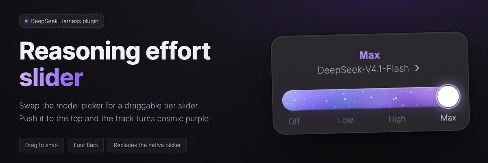
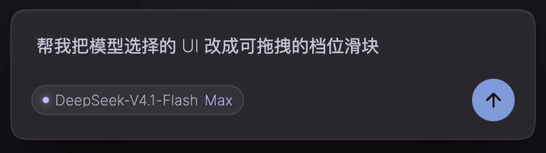
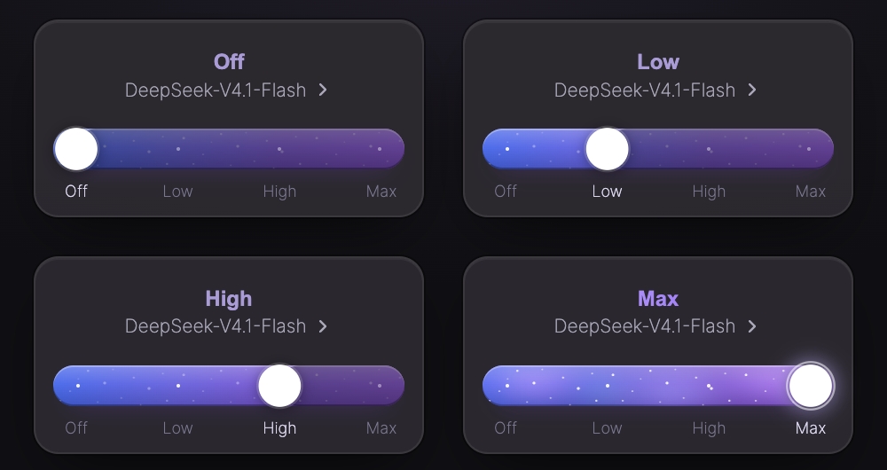
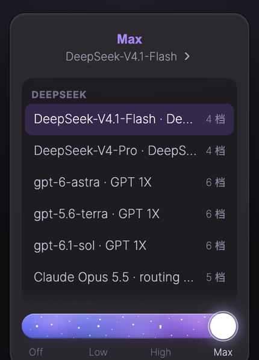

<p align="center">
  
</p>

<h1 align="center">Reasoning effort slider</h1>

<p align="center"><b>A DeepSeek Harness plugin. It swaps the composer's model picker for a tier slider you can drag.</b></p>

<p align="center">Push it to the top and the whole track turns cosmic purple.</p>

<p align="center">
  <a href="#install"><b>Install</b></a> ·
  <a href="#four-tiers">Four tiers</a> ·
  <a href="#switching-models">Switching models</a> ·
  <a href="#faq">FAQ</a> ·
  <a href="README.md">中文</a>
</p>

<p align="center">
  
  
  <a href="LICENSE"></a>
  <a href="https://github.com/Winjazw/dsh-effort-tiers/stargazers"></a>
</p>

<br>

## What it is

A small control that sits in the DeepSeek Harness composer, exactly where the model button used to be.

Open it and you get a popover with three things: the current tier, the current model, and a track you can drag.

<div align="center">
  
</div>

Collapsed, it leaves one pill in the composer: `● DeepSeek-V4.1-Flash  Max ›`.

Both the full model name and the tier are visible at a glance.

<br>

## Four tiers

<div align="center">
  
</div>

The tiers are not hard-coded. They come from the reasoning efforts each model declares — some models have four, some have six.

A model that declares none shows "no reasoning tiers" and the slider turns into a disabled state.

**Dragging tracks your pointer.** It follows 1:1 while held, then eases to the nearest tier on release.

**The keyboard works too.** Arrow keys step one tier; `Home` and `End` jump to the ends.

<br>

## The top tier

The particles are computed live, not an image.

Four nebula blobs drift slowly, more than a hundred stars twinkle and slide left, and an aurora band sweeps across the track.

Energy only lights up over the last 44% of the travel. `High` is a faint glow; `Max` is full power.

<br>

## Switching models

Click the top part of the popover — the whole tier-and-model block — and the model list opens.

<div align="center">
  
</div>

- Grouped by provider, with each model's tier count on the right.
- Long names are ellipsized on one line, with the full text on hover, so rows keep a uniform height.
- The list fades at the edge only while there is more to scroll; at the end the fade goes away and the rounded corner shows through.

Picking a model resets the effort to that model's default tier.

<br>

## Install

Requires DeepSeek Harness `0.2.2-rc.5` or later.

**1. Get the source.**

```bash
git clone https://github.com/Winjazw/dsh-effort-tiers.git
```

**2. Add it to your profile.** Use `web` instead of `desktop` for the web build:

```bash
dsh plugin --profile desktop add /path/to/dsh-effort-tiers
```

If `dsh` is not on your PATH, use "Manage dsh command" from the desktop app menu first.

**3. Restart DeepSeek Harness.** The model picker in the composer becomes the slider.

If it does not show up, press `Cmd + R` to reload the window.

**Uninstall**: `dsh plugin --profile desktop remove dsh-effort-tiers`, then restart. Your model settings and keys are untouched.

> Source install only for now — `dsh-effort-tiers` is not on npm yet, so `add dsh-effort-tiers` will not work.

<br>

## Compatibility and limits

| | Notes |
| --- | --- |
| **Host version** | Tested on `0.2.2-rc.5`, macOS desktop. Needs the `slots` and `modelDirectories` client services |
| **What it replaces** | It occupies the `conversation.input.model` slot, which is the native model picker. Remove the plugin and the original returns |
| **Where tiers come from** | `reasoning.efforts` in the model catalog. The plugin never invents tiers |
| **How it switches** | Through the host's own `sessions.selectModel`, scoped to the current session |
| **Styling note** | Every rounded corner sets `corner-shape: round`, because the host defaults to `squircle` |

<br>

## FAQ

<details>
<summary><b>Does it change the model I picked somewhere else?</b></summary>
<br>

No. The switch is sent to the current session only; other sessions and the default for new ones are untouched.
</details>

<details>
<summary><b>Does the top tier actually run slower?</b></summary>
<br>

The slider only selects an effort the model already declares. How slow that is depends on the model. The plugin adds no prompt text and changes no request content.
</details>

<details>
<summary><b>Can I change only the colors or the size?</b></summary>
<br>

Yes. The CSS lives at the top of `client.js` — sizes are a few constants, colors are a few `linear-gradient` lines. `Cmd + R` after editing; no reinstall needed.
</details>

<details>
<summary><b>Why is the knob drawn as SVG instead of CSS?</b></summary>
<br>

Because the host sets `corner-shape: squircle` globally, which turns `border-radius: 50%` into a rounded square. The knob is a real SVG circle so it stays round. The track's caps opt back in with `corner-shape: round`.
</details>

<details>
<summary><b>Is this made by DeepSeek?</b></summary>
<br>

No, it is a community plugin.
</details>

<br>

## Development

```bash
git clone https://github.com/Winjazw/dsh-effort-tiers.git
ELECTRON_RUN_AS_NODE=1 "DeepSeek Harness" --check client.js   # syntax check
```

Install it into a profile as a link, then `Cmd + R` after editing `client.js` — no reinstall.

| File | What it is |
| --- | --- |
| `client.js` | The whole UI: CSS, component, drag logic, SVG icons |
| `index.js` | Host half, empty (this plugin is client-only) |
| `cordis.patch.yml` | The patch that inserts the plugin into a profile |
| `locale/` | Chinese and English plugin title, description, detail |
| `docs/assets/` | The images on this page, rendered from the real styles |
| `assets/` | Screenshots used by the plugin marketplaces |

Editing `index.js` needs a full restart; editing `client.js` only needs a reload.

<br>

## License

[MIT](LICENSE)

A community plugin, not affiliated with DeepSeek. DeepSeek Harness names and marks belong to their owners.
