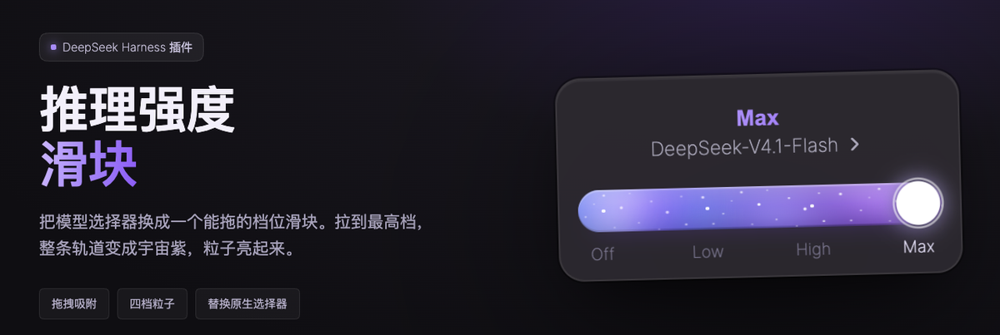
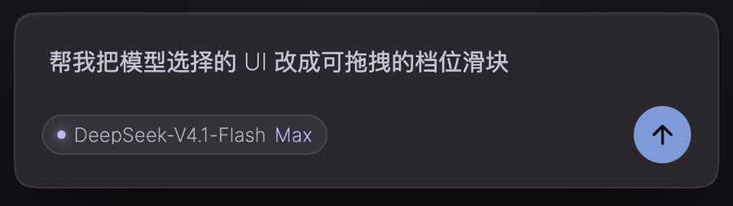
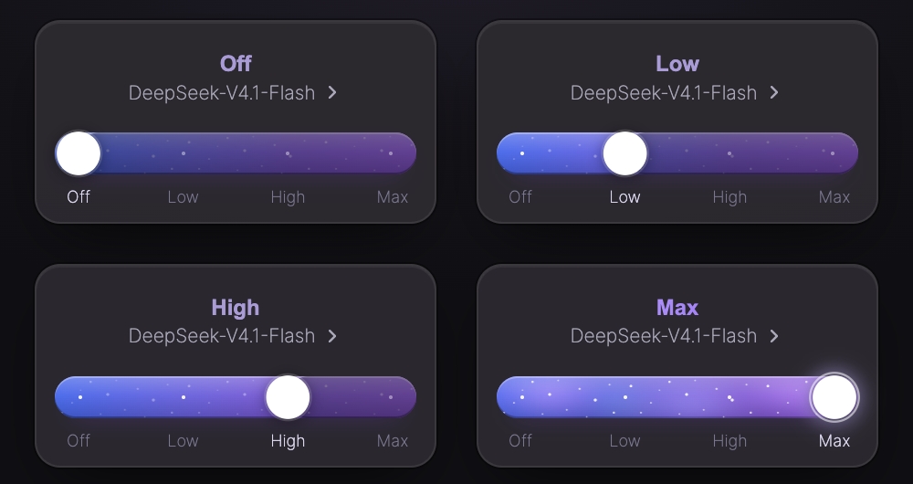
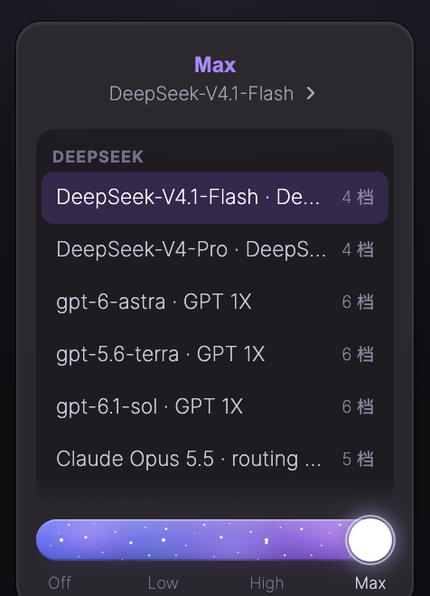

<p align="center">
  
</p>

<h1 align="center">推理强度滑块</h1>

<p align="center"><b>DeepSeek Harness 的一个插件。把输入框里的模型选择器，换成一个能拖的档位滑块。</b></p>

<p align="center">拖到最高档，整条轨道变成宇宙紫，星点和星云亮起来。</p>

<p align="center">
  <a href="#怎么装上"><b>安装</b></a> ·
  <a href="#四档">四档</a> ·
  <a href="#换模型">换模型</a> ·
  <a href="#问答">问答</a> ·
  <a href="README.en.md">English</a>
</p>

<p align="center">
  
  
  <a href="LICENSE"></a>
  <a href="https://github.com/Winjazw/dsh-effort-tiers/stargazers"></a>
</p>

<br>

## 它是什么

装在 DeepSeek Harness 输入框里的一个小控件，位置就是原来那个选模型的按钮。

点开是一个浮层，从上到下三样东西：当前档位、当前模型、一条能拖的轨道。

<div align="center">
  
</div>

收缩回去之后，输入框里留下一个胶囊：`● DeepSeek-V4.1-Flash  Max ›`。

模型全名和档位都在里面，一眼能看清现在是什么状态。

<br>

## 四档

<div align="center">
  
</div>

档位不是写死的四个，而是读模型自己声明的推理强度。有的模型 4 档，有的 6 档。

没有声明档位的模型，会显示「无推理档位」，滑块变成不可拖的状态。

**拖动是跟手的。** 按下就跟着鼠标走，松手吸附到最近一档，不会滑过头。

**键盘也能用。** 左右方向键一档一档切，`Home` 和 `End` 直接到两头。

<br>

## 最高档

轨道的粒子是实时算的，不是图片。

四团星云在缓慢漂移，一百多颗星点各自闪烁并且缓慢左移，还有一条极光带横向扫过整条轨道。

能量只在行程的最后 44% 亮起来。换句话说：`High` 只是微光，`Max` 才是满功率。

这样滑块的每一档在手感上都不太一样，而不是从头到尾一个样。

<br>

## 换模型

点浮层上半部分（档位和模型名那一整块），展开模型列表。

<div align="center">
  
</div>

- 按服务商分组，每行右边标着这个模型有几档。
- 名字太长就单行省略号，鼠标悬停能看到全名，行高不会被撑歪。
- 列表底部有渐隐，暗示还能往下滚；滚到底了渐隐消失，露出完整的圆角。

选中一个模型，推理强度会重置成这个模型的默认档。

<br>

## 怎么装上

要求 DeepSeek Harness `0.2.2-rc.5` 及以上。

**1. 拿源码。**

```bash
git clone https://github.com/Winjazw/dsh-effort-tiers.git
```

**2. 装进你的 profile。** `desktop` 换成 `web` 就是网页版：

```bash
dsh plugin --profile desktop add /path/to/dsh-effort-tiers
```

终端里没有 `dsh` 命令的话，先在桌面版菜单里选「管理 dsh 命令」。

**3. 在「插件」页里启用它。** 列里会出现「推理强度滑块」，打开开关。

**4. 重启 DeepSeek Harness**，输入框里的模型选择器就变成了滑块。

没生效就 `Cmd + R` 刷新一次窗口。

**卸载**：`dsh plugin --profile desktop remove dsh-effort-tiers`，重启即可。不会动你的模型配置和密钥。

> 目前只有源码安装。npm 上还没有发布 `dsh-effort-tiers`，所以不能直接 `add dsh-effort-tiers`。

<br>

## 兼容与限制

| | 说明 |
| --- | --- |
| **宿主版本** | 在 `0.2.2-rc.5` 的 macOS 桌面版上测过，依赖 `slots` 与 `modelDirectories` 两个客户端服务 |
| **替换范围** | 占的是 `conversation.input.model` 这个单槽位，也就是原生的模型选择器；把它卸掉就会还原 |
| **档位来源** | 来自模型目录里的 `reasoning.efforts`，插件不自己造档位 |
| **切换方式** | 走宿主自己的 `sessions.selectModel`，只改当前会话，不改全局默认值 |
| **样式前提** | 圆角都显式写了 `corner-shape: round`，因为宿主默认是 `squircle` |

<br>

## 问答

<details>
<summary><b>会不会改掉我在别的地方选的模型？</b></summary>
<br>

不会。切换是发给当前会话的，其它会话和新建会话的默认值都不受影响。
</details>

<details>
<summary><b>最高的那一档，真的会跑得更慢吗？</b></summary>
<br>

滑块只是把模型自己声明的推理强度选上去，跑多慢取决于模型。插件不额外加提示词，也不改请求内容。
</details>

<details>
<summary><b>能只改颜色和大小吗？</b></summary>
<br>

可以。`client.js` 顶部有一段 CSS，尺寸是 `--INK`、轨道高度、白点直径几个常量，颜色是几条 `linear-gradient`。改完 `Cmd + R` 就生效，不用重装。
</details>

<details>
<summary><b>为什么白点是圆形的，不是圆角方块？</b></summary>
<br>

因为宿主把全局圆角设成了超椭圆（`corner-shape: squircle`），`border-radius: 50%` 会被拉方。

所以白点是画出来的 SVG 圆，不受这条规则影响。轨道两端的半圆头则统一加了 `corner-shape: round`。
</details>

<details>
<summary><b>这是 DeepSeek 做的吗？</b></summary>
<br>

不是，是社区插件。
</details>

<br>

## 开发

```bash
git clone https://github.com/Winjazw/dsh-effort-tiers.git
ELECTRON_RUN_AS_NODE=1 "DeepSeek Harness" --check client.js   # 语法检查
```

用 `link` 方式装进 profile 之后，改完 `client.js` 只要 `Cmd + R` 刷新窗口就生效，不用重装。

| 文件 | 内容 |
| --- | --- |
| `client.js` | 整个界面：CSS、组件、拖动逻辑、SVG 图标 |
| `index.js` | Host 半边，空的（这个插件只有客户端） |
| `cordis.patch.yml` | 把插件插进 profile 的补丁 |
| `locale/` | 中文和英文的插件标题、描述、详情 |
| `docs/assets/` | 本页的图，全部由插件真实样式渲染后截的 |
| `assets/` | 插件市场的截图 |

改 `index.js` 要重启 DeepSeek Harness，改 `client.js` 只要刷新。

<br>

## 许可

[MIT](LICENSE)

社区插件，与 DeepSeek 无关。DeepSeek Harness 的名称和标识归其所有者所有。
