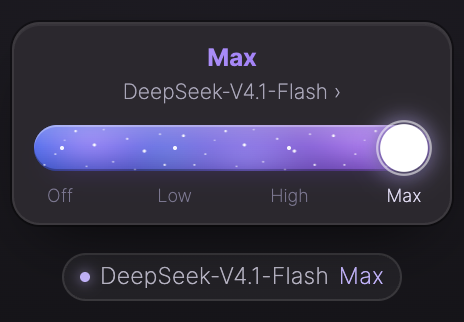

# dsh-effort-tiers

A draggable reasoning-effort slider that takes the place of the composer's model picker. The top tier turns the track into a drifting cosmic particle field.

## What it does

- Replaces the model picker in the composer with a pill that shows the current model name and its reasoning tier.
- Opening the pill shows the panel: tier name, model row, and a horizontal track.
- Drag the track to change reasoning effort; on release it snaps to the nearest tier. Arrow keys move one tier, Home and End jump to the ends.
- Tiers come from the current model's own `reasoning.efforts`, so the number of stops follows the model. Models that declare no efforts show the control as unavailable.
- The particle field only lights up over the last stretch of the travel. The topmost tier is the full cosmic field; middle tiers are a faint glow; the lowest tier is dark.
- The model row in the panel expands to a list, and picking a row switches the session to that model.

Changes go through `session.selectModel`, the same path the built-in picker uses.

## Install

From the plugin market, once listed, or directly from this repository:

1. Open **Plugins** and add this repository as a plugin source:
   `https://github.com/Winjazw/dsh-effort-tiers`
2. Reload the window (Cmd+R / Ctrl+R). The pill replaces the model picker in the composer.

## Compatibility

Compatible with DSH `>=0.2.2-rc.5`, web client.

## How it works

- `package.json` declares `dsh.bundle.patch` and a web `dsh.client` half; `cordis.patch.yml` inserts the bundle row.
- `client.js` registers a component on the `conversation.input.model` slot, reads the model directory through `modelDirectories`, and writes selections with `directory.select(...)`.
- The track, knob and stars are CSS only. DSH sets a global `corner-shape: squircle`, so every rounded surface here opts back into `corner-shape: round`.

## License

MIT.

---

# dsh-effort-tiers 中文说明

一个可以拖动的推理强度滑块，替换输入框里的模型选择器。拖到最高档，轨道会变成流动的宇宙粒子场。

## 功能

- 输入框里的模型选择器换成一枚胶囊，显示当前模型名和推理档位。
- 点开胶囊是面板：档位名、模型行、一条横向轨道。
- 拖动轨道改推理强度，松手吸附到最近一档。方向键逐档，Home 和 End 到两端。
- 档位来自当前模型自己声明的 `reasoning.efforts`，档数跟着模型走。没有声明档位的模型显示为不可用。
- 粒子只在最后一段行程点亮：最高档才是完整宇宙场，中间档只是微光，最低档全暗。
- 面板里的模型行可以展开成列表，点一行就把会话切到那个模型。

切换走 `session.selectModel`，和内置选择器是同一条路。

## 安装

上架插件市场后可从市场安装，也可以直接从仓库装：

1. 打开**插件**，把仓库地址加为插件来源：
   `https://github.com/Winjazw/dsh-effort-tiers`
2. 刷新窗口（Cmd+R / Ctrl+R）。输入框里的模型选择器会变成这枚胶囊。

## 兼容

需要 DSH `>=0.2.2-rc.5`，网页端。

## 实现说明

- `package.json` 声明 `dsh.bundle.patch` 和网页端 `dsh.client`；`cordis.patch.yml` 插入组合包条目。
- `client.js` 在 `conversation.input.model` 槽位注册组件，通过 `modelDirectories` 读取模型目录，用 `directory.select(...)` 写入选择。
- 轨道、白点、星点全部是 CSS。DSH 全局设了 `corner-shape: squircle`，所以这里的每个圆角都显式写回 `corner-shape: round`。

## 许可

MIT。
