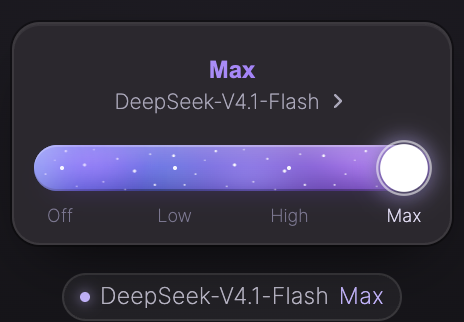
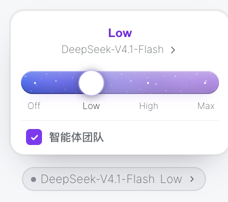

# 推理强度滑块

输入框里的模型选择器换成了一枚胶囊，显示当前模型名和推理档位。点开它就是一条 23px 的轨道。

- 轨道可拖拽，松手吸附到最近的档位。
- 键盘 ← → 逐档，Home / End 到两端。
- 档位来自当前模型自己声明的 `reasoning.efforts`，没有档位的模型会显示为不可用。
- 只有最后一段行程点亮粒子：最高档才是宇宙粒子场。
- 面板里的模型行可以展开，直接切换到另一个模型。
- 面板最底部有一个「智能体团队」勾选框，和内置开关等价：读同一个 `agentTeam` 投影，写同一个 `agentTeams.setEnabled`。子智能体会话里不显示。

切换走的是 `session.selectModel`，和内置模型选择器用的是同一条路。
配色跟随主题：文字和边框用 `--dsw-alias-*` token，浅色模式下模型名不再发灰。

